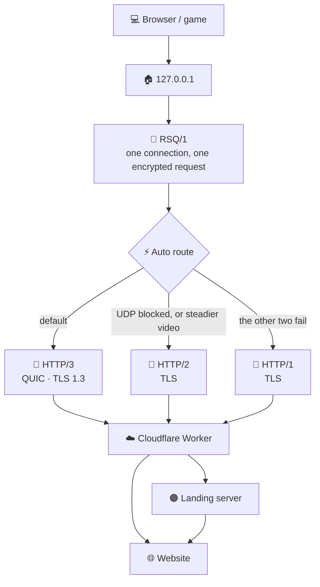

# 🐵 TiaoTiaoHou

TiaoTiaoHou is a VPN that uses **Cloudflare Workers**. Tap once to connect. Web, YouTube, and games use its own protocol, with HTTP/3 by default.

Cloudflare gives each user a free quota you can use directly. The Worker path is about 100,000 requests a day, and the home screen shows how much you have used. It works without your own server. If you have one, you can add a landing server automatically.

| System | Download | How |
| --- | --- | --- |
| 🪟 Windows | [tiaotiaohou-Setup.exe](https://github.com/luuuunet/tiaotiaohou/releases/download/windows/tiaotiaohou-Setup.exe) | Double-click to install |
| 🍎 macOS | [tiaotiaohou-macos.zip](https://github.com/luuuunet/tiaotiaohou/releases/download/windows/tiaotiaohou-macos.zip) | Unzip and open. If blocked, allow it in System Settings → Privacy & Security |
| 🤖 Android | [tiaotiaohou.apk](https://github.com/luuuunet/tiaotiaohou/releases/download/windows/tiaotiaohou.apk) | After install, set apps to `127.0.0.1:1080`. Allow notifications and background running |

🛠️ After install:

1. Open **Setup** on the left, or import a node under **Nodes**.
2. Go back to **Connect** and tap the yellow area, or **Connect**.
3. 🎯 Keep **Best IP** on. If the address is slow, tap **Another**.
4. 🌐 The browser follows. 🎮 For games, use `127.0.0.1:1080`.

## 🔌 Connect

This is the page you use every day. If the node goes through a Cloudflare Worker, traffic uses the free quota above.

- 🔗 Pick a node at the top. The card below switches to it.
- 🟢 Green marks show what works: web, orange-cloud sites, and game UDP.
- 📶 The middle measures ping, download, and upload.
- 🎯 **Best IP** picks a faster Cloudflare address automatically.
- 🌙 If it gets slow at night, tap **Another**. A live connection switches over.
- 🎬 YouTube can play at 4K. Web prefers HTTP/3. Video moves to HTTP/2 when that is steadier.

## 📋 Nodes

You can keep many nodes. Tap one to connect.

- 📥 **Import**: paste one node or a batch.
- ➕ **Add**: type one yourself.
- ✅ **Test**: checks whether it works, not how fast.
- 🎁 **Share**: set an expiry and a use limit, or turn it off.
- 🔄 **Subscription**: paste a URL. It retries, and nodes you added by hand stay.

Each row shows the path: Cloudflare direct, orange cloud + server, or Worker + landing. Recognized country names show a flag.

## 🛠️ Setup

If you have a server, use the recommended **Orange cloud + server**. Fill in the token, domain, public IP, and root password, then tap **Set up**. The rest is automatic.

| | Path | For |
| --- | --- | --- |
| 🟠 **Orange cloud + server** | The domain goes through Cloudflare and back to your server. No Worker. Web prefers HTTP/3, and game UDP works. | You already have a server. |
| 🧩 **Worker + server** | Web hits the Worker first, then leaves from your server. | When the orange-cloud origin is unstable. |
| ☁️ **Cloudflare only** | Domain only, no server of your own. Ordinary sites open. Game UDP does not. | You do not have a server yet. |

One machine can run two setups. Use two different domains. If some sites will not open, turn on **Open blocked sites** under Device.

## ⚙️ Device

These are switches. Change them and save.

- 🚪 **Exit**: Cloudflare direct, Worker + landing, orange cloud + server, or direct VPS.
- ⚡ **Faster route**: switches automatically when a path fails. Video picks its own.
- 🎯 **Best Cloudflare IP**: picks a faster address. You can rescan or try another.
- 🌐 **Open blocked sites**: use this only with Cloudflare and no server. Restart the browser after.
- 🖥️ **System proxy**: the browser follows. It listens only on `127.0.0.1`, HTTP `8080`, SOCKS `1080`.
- 🇨🇳 **China sites direct**: Baidu and Taobao stay off the proxy.
- 🔀 **Switch node if down**: tries the next node.
- 🚧 **Hold if dropped**: a drop does not leak onto the real network. Disconnect or quit still turns the proxy off.
- 🔌 **Start at login**: connects quietly, and reconnects when the network changes.

## 🔐 Protocol

The protocol is **RSQ/1**. One local connection becomes one encrypted request. The body is the raw bytes, with no extra framing in the middle.

- 🚀 **HTTP/3**: default. TLS 1.3 over QUIC, for web and video.
- 🔁 **HTTP/2**: used when UDP is blocked, or when video is steadier on this path.
- 🛟 **HTTP/1**: the fallback when the other two do not connect.

## 📜 License

This software is provided under the [MIT License](LICENSE). You may use, copy, and modify it free of charge. Keep the copyright notice. It is provided as is, without warranty.
