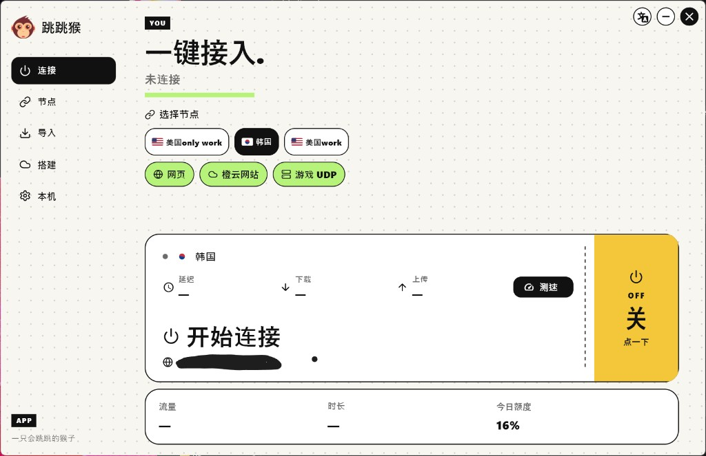
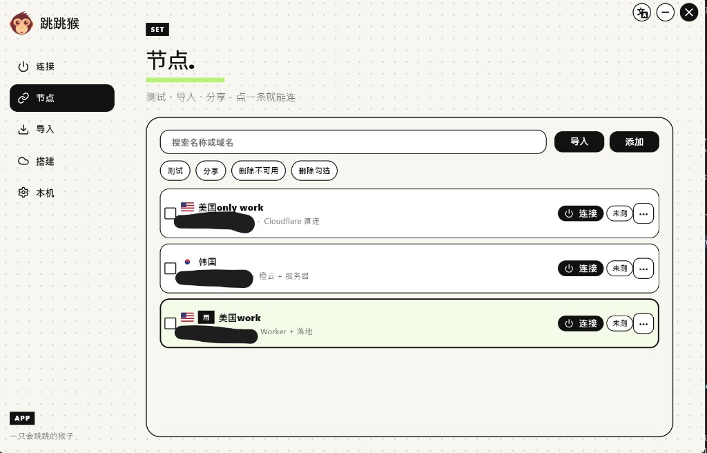
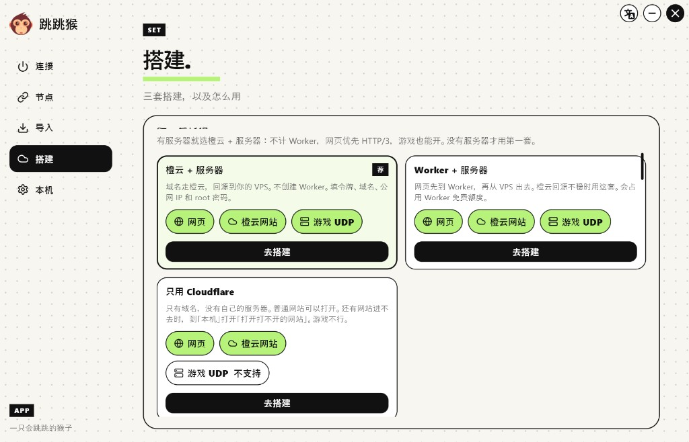
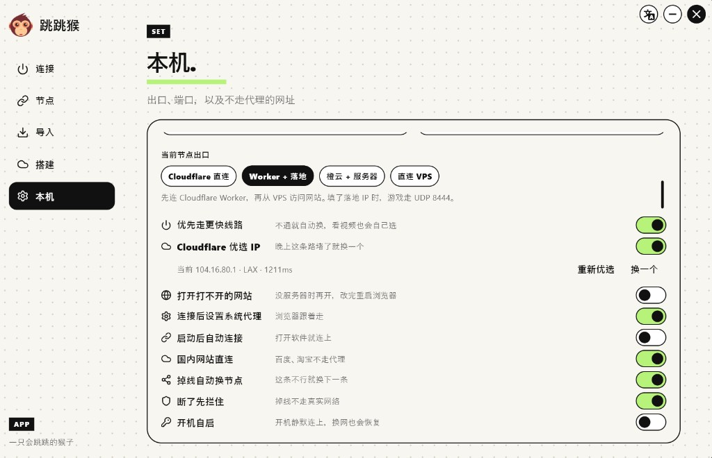
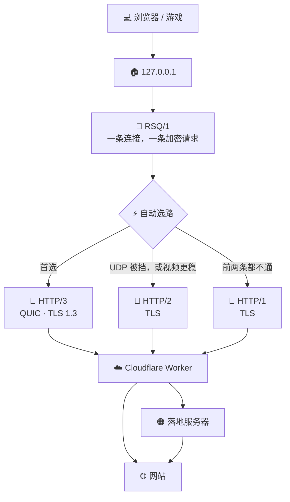

# 🐵 跳跳猴

跳跳猴是使用 **Cloudflare Worker** 的 VPN。点一下就接入，网页、YouTube 和游戏走自己的通讯协议，外面默认套 HTTP/3。

Cloudflare 给用户一份免费额度，可以直接用。Worker 这条路大约每天 10 万次请求，首页能看到今天用了多少。没有自己的服务器也能用；有服务器时可以再自动搭一条落地。

| 系统 | 下载 | 怎么用 |
| --- | --- | --- |
| 🪟 Windows | [tiaotiaohou-Setup.exe](https://github.com/luuuunet/tiaotiaohou/releases/download/windows/tiaotiaohou-Setup.exe) | 双击安装 |
| 🍎 macOS | [tiaotiaohou-macos.zip](https://github.com/luuuunet/tiaotiaohou/releases/download/windows/tiaotiaohou-macos.zip) | 解压后打开。若被拦住，到「系统设置 → 隐私与安全性」点仍要打开 |
| 🤖 Android | [tiaotiaohou.apk](https://github.com/luuuunet/tiaotiaohou/releases/download/windows/tiaotiaohou.apk) | 安装后在应用里填 `127.0.0.1:1080`。连上后允许通知，并同意在后台继续运行 |

🛠️ 装好后按这四步：

1. 左侧 **搭建**，或在 **节点** 里导入一条已经有的配置。
2. 回到 **连接**，点黄色区域或「开始连接」。
3. 🎯 **优选 IP** 保持打开。地址慢了，点 **换一个**。
4. 🌐 浏览器会跟着走。🎮 游戏填 `127.0.0.1:1080`。

## 🔌 连接

这是平时用的页面。当前节点如果走 Cloudflare Worker，流量就用上面的免费额度。

- 🔗 上面选节点。点哪一条，下面就换成哪一条。
- 🟢 绿色标记表示能开什么：网页、橙云网站、游戏 UDP。
- 📶 中间可以测延迟、下载和上传。
- 🎯 **优选 IP** 会自动挑一条更快的 Cloudflare 地址。
- 🌙 晚上变堵就点 **换一个**。正在连接时会按新地址重接。
- 🎬 看 YouTube 可以开到 4K。网页优先 HTTP/3，视频不稳时改走 HTTP/2。

## 📋 节点

节点可以有很多条，点一条就能连。

- 📥 **导入**：贴一条或一批配置。
- ➕ **添加**：自己填一条。
- ✅ **测试**：只看这条现在能不能用。
- 🎁 **分享**：可以设过期时间和次数，也可以停用。
- 🔄 **订阅**：填地址。失败会再试，手动加的节点不会被冲掉。

列表里能看到走法：Cloudflare 直连、橙云 + 服务器、Worker + 落地。名字里能认出的国家会显示国旗。

## 🛠️ 搭建

有服务器就点推荐的 **橙云 + 服务器**。填令牌、域名、公网 IP 和 root 密码。证书可以 **自动申请**，也可以贴 **自己的证书**。点 **去搭建**，剩下的自动完成。

| | 怎么走 | 适合 |
| --- | --- | --- |
| 🟠 **橙云 + 服务器** | 域名走橙云，回到你的服务器。不创建 Worker。网页优先 HTTP/3，游戏 UDP 也能开。 | 已经有一台服务器。 |
| 🧩 **Worker + 服务器** | 网页先到 Worker，再从服务器出去。 | 橙云回源不稳的时候。 |
| 🏠 **域名 + 服务器** | 不经过 Cloudflare。域名的 A 记录直接指到服务器，证书自动申请。网页和游戏都从这台机器出去。 | 域名已经能改到你的服务器。 |
| ☁️ **只用 Cloudflare** | 只有域名，没有自己的服务器。普通网站可以打开。游戏 UDP 不行。 | 还没有服务器。 |

同一台机器可以两套一起用，请用两个不同域名。有的网站进不去时，到本机打开「打开打不开的网站」。

## ⚙️ 本机

这里是开关，改完保存即可。

- 🚪 **当前节点出口**：Cloudflare 直连、Worker + 落地、橙云 + 服务器、直连 VPS。
- ⚡ **优先走更快线路**：不通就自动换。看视频也会自己选。
- 🎯 **Cloudflare 优选 IP**：自动挑更快的地址，也可以重新优选或换一个。
- 🌐 **打开打不开的网站**：只用 Cloudflare、没有服务器时再开。改完重启浏览器。
- 🖥️ **连接后设置系统代理**：浏览器跟着走。只听 `127.0.0.1`，浏览器 `8080`，SOCKS `1080`。
- 🇨🇳 **国内网站直连**：百度、淘宝不绕出去。
- 🔀 **掉线自动换节点**：这条不行就换下一条。
- 🚧 **断了先拦住**：掉线不走真实网络。自己断开或退出仍会关掉代理。
- 🔌 **开机自启**：开机静默连上，换网也会恢复。

## 🔐 协议

通讯协议是自己的 **RSQ/1**。一条本地连接变成一条加密请求，正文是原始字节，中间不再拆包。

- 🚀 **HTTP/3**：默认。QUIC 上的 TLS 1.3，适合打开网页和看视频。
- 🔁 **HTTP/2**：UDP 被挡住，或者视频这条路更稳时用。
- 🛟 **HTTP/1**：前两条都不通时的保底。

## 📜 使用条款

本软件按 [MIT](LICENSE) 协议提供，可以免费使用、复制和修改。保留版权声明即可。软件按现状提供，不附带担保。
